# Kosika Designs

You ask a question and get back a drawing that explains it. The explanation
is written into the drawing, one step at a time. Hover over a step and the
part it talks about lights up. Kosika checks the drawing's mathematics and
corrects it, and it shows real photos only where they help.

Kosika Designs runs on free and open models only, through Groq and
OpenRouter. Its photos are freely licensed, and each one is credited on the
page.


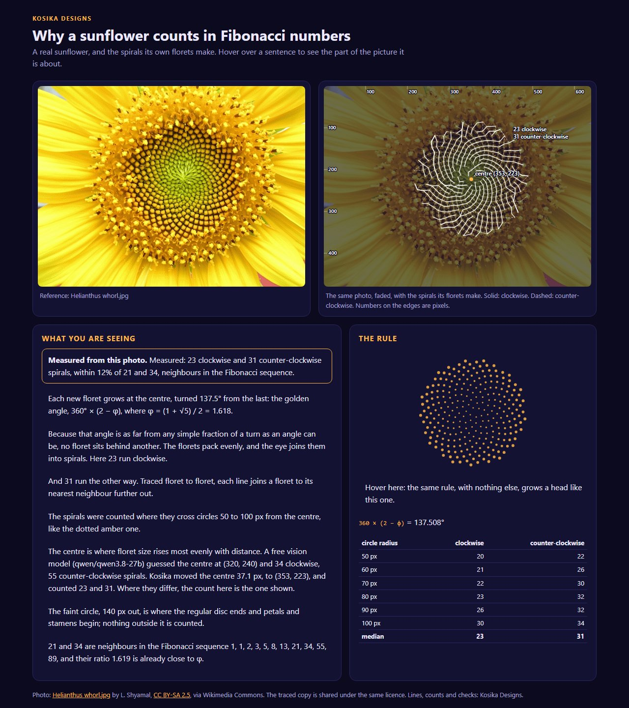

## Try it

Kosika Designs needs the Kosika language next to it, in one folder:

```text
git clone https://github.com/blackhole8080-darkmatter/kosika
git clone https://github.com/blackhole8080-darkmatter/kosika-designs
cd kosika && python -m pip install . && cd ../kosika-designs
python -m pip install numpy pillow scipy      # for the photo finder
.\design.ps1 "how does an LLM work"           # writes design.html
```

The drawing code itself lives in Kosika's standard library
(`kosika/std/designs*.kos`). This repo holds the agents that use it, the
photo finder, the hand-made art, the benchmark and the pictures you see here.
A free Groq key (`GROQ_API_KEY`) is all it needs to talk to a model.

## What it draws

### A cycle, with icons inside its boxes

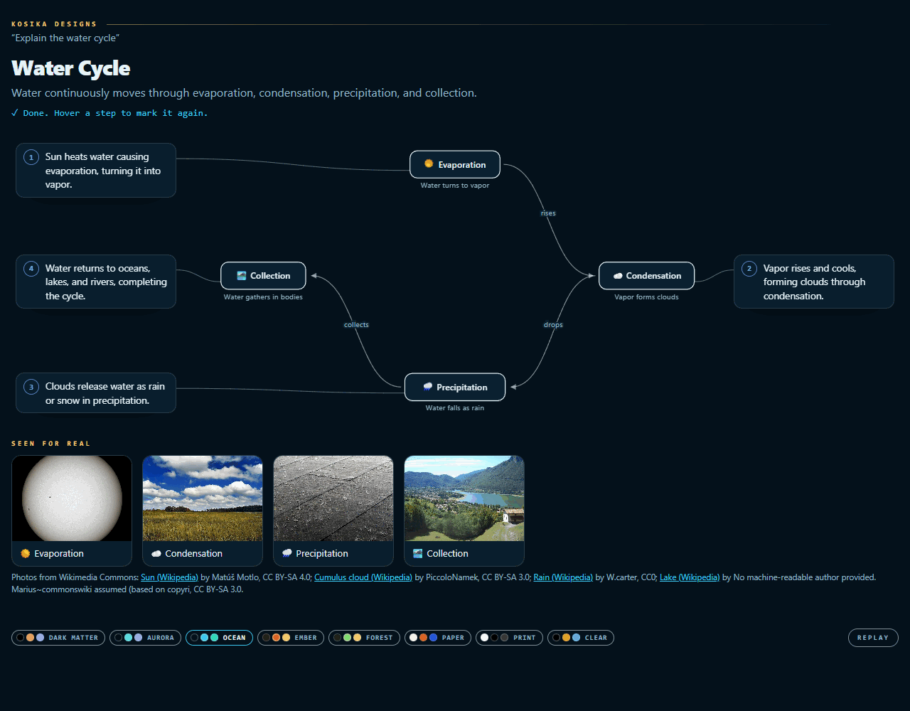

Each box gets an emoji that moves the way its thing does. The sun turns, a
cloud drifts and rain drips. When a step is marked, its icon moves faster.

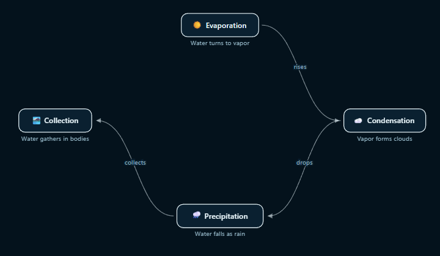

### A mind map

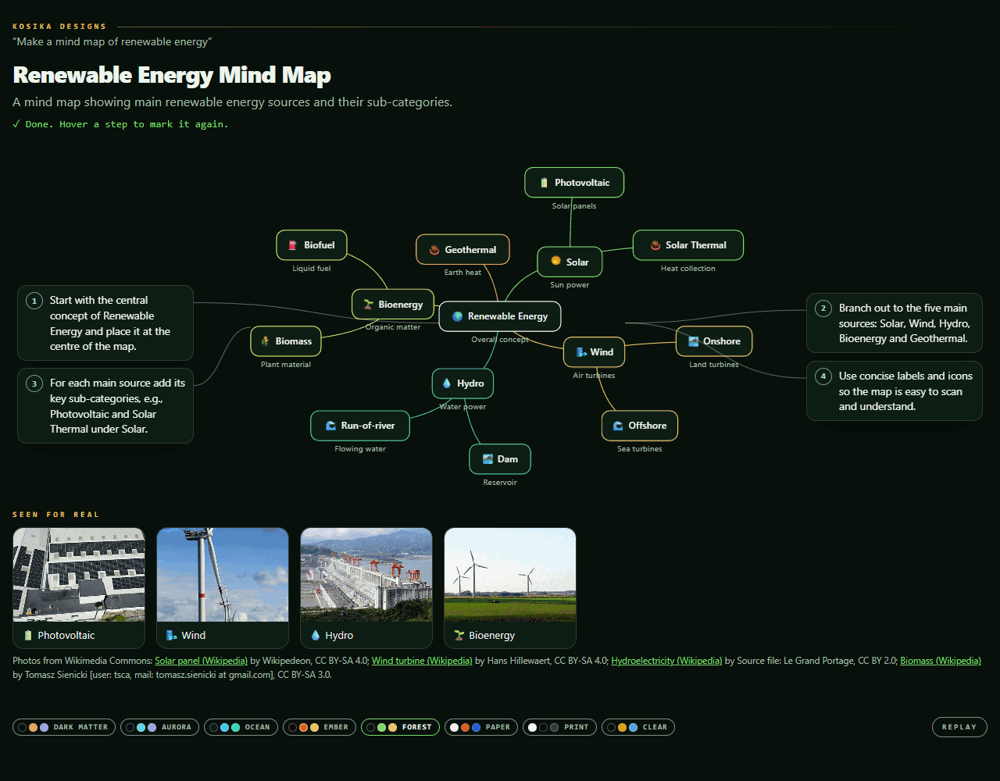

### A sequence, an orbit and containers

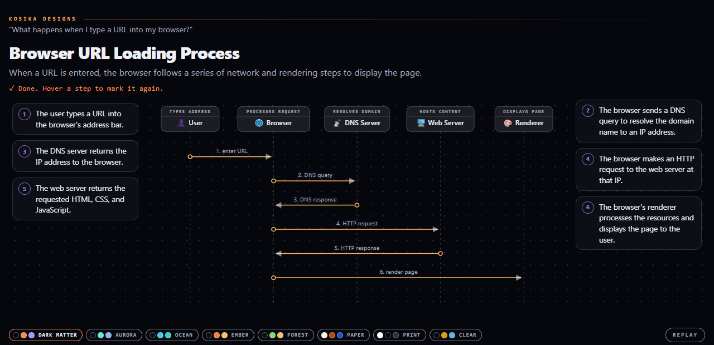

A **sequence** puts the actors along the top, each with a dashed lifeline.
Their messages run between the lifelines in time order, one numbered row
each, so a request and its reply read from top to bottom.

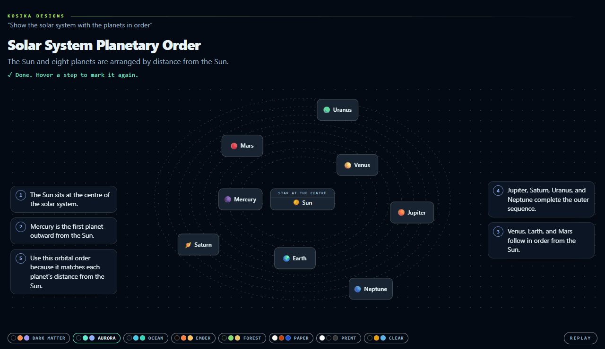

An **orbit** puts one thing at the centre and the rest on rings, in order
outward from it. Each card is placed round its ring by the golden angle,
so no two land on the same side.

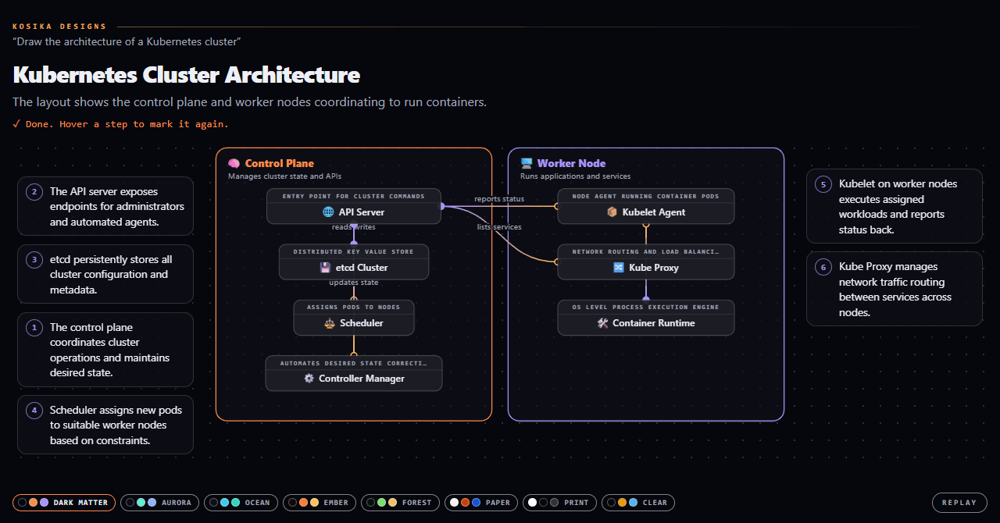

**Containers** are boxes holding cards, with links between any two cards.
They suit a system's architecture, a cluster or a cell's organelles.

Kosika also picks these kinds from the question itself. "When I type",
"handshake" or "sequence diagram" gives a sequence. "Solar system",
"planets" or "electron shell" gives an orbit. "Architecture", "cluster" or
"organelles" gives containers.

### A comparison, as a table

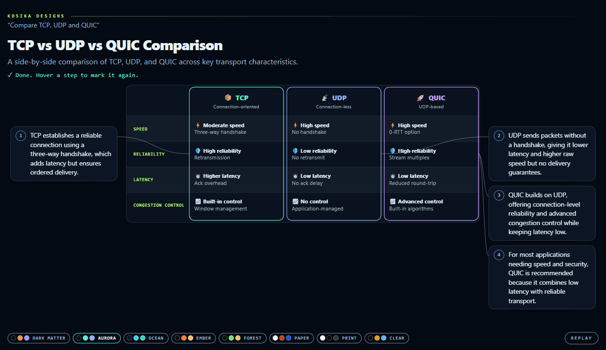

Any question that sets things against each other is drawn as a table,
whatever the planner first chose. That covers "compare", "vs", "difference
between" and "should I learn Rust or Go". Each row is named on the left and
sized to fit its longest cell. When the question asks which to choose, the
last step gives a recommendation and the reason for it.

### Any screen: a website, a phone app, an agent window

Ask for a screen and Kosika designs it. A model writes only what the screen
says and which blocks it is made of (a nav, a hero, cards, a list, a chat,
a tab bar). Kosika checks that description and draws every block itself, in
one design system: one type scale, one spacing scale, one accent with a
partner colour, and its own line icons. So a small or offline model designs
as well as a big one, and every design looks finished.

Designs are vivid by default. They use gradients in the two colours, glass
with a glowing edge, and light that drifts behind the opening. Parts rise in
as you scroll, numbers count up, and charts (line, area, bar, ring) draw
themselves. All motion stops when your device asks for reduced motion. Say
"minimal" in the ask to get the calm, still version.

The model also chooses the look: its own colours, which Kosika keeps
readable, the shape of things, the type, and the moving art behind the
design (orbits, blobs, waves, constellation, prism, rings, grid, aurora).
The art is drawn fresh from the words of the ask, so no two designs are
alike. An art block lets it compose its own moving shapes too.

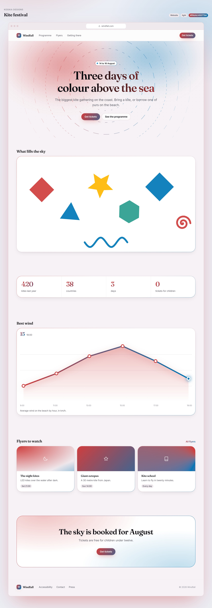

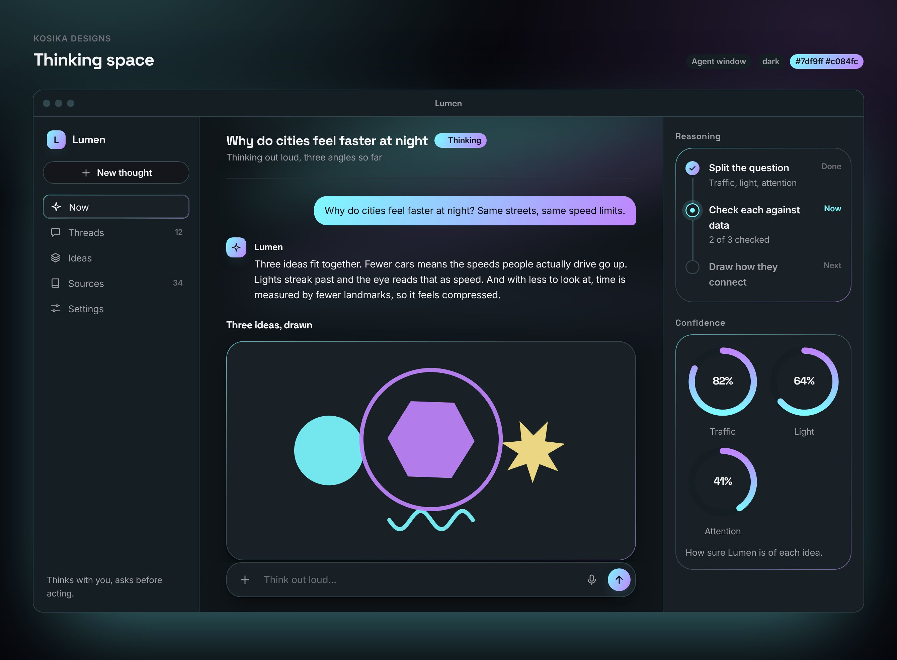

```text
.\ui.ps1 "a landing page for a quiet coffee shop"
```

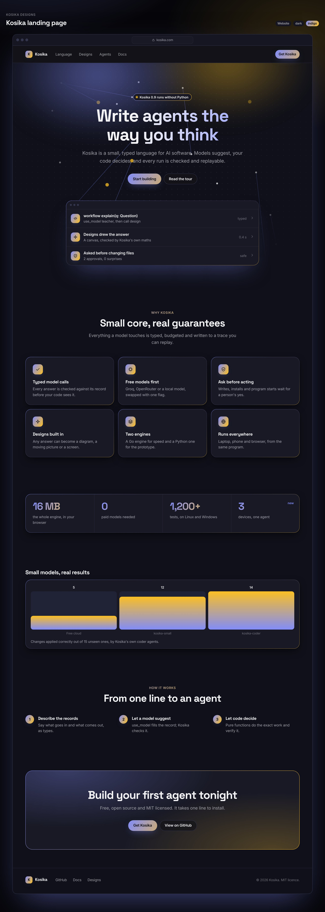

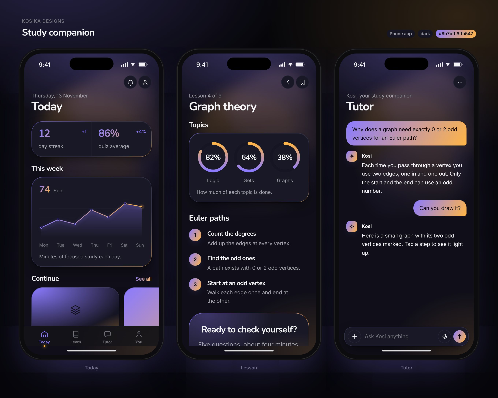

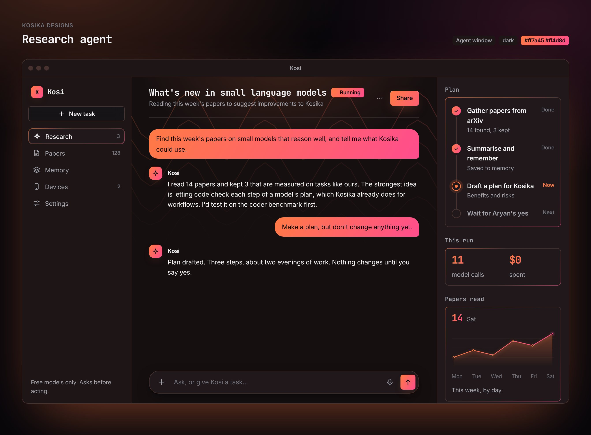

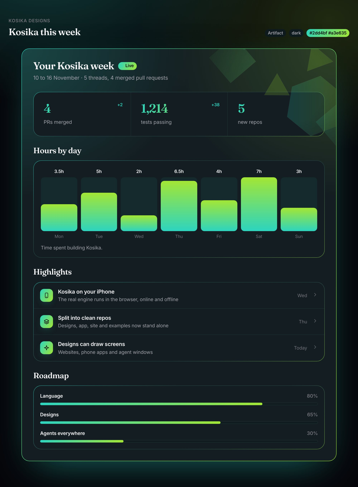

Four targets: **web** (in a browser window, responsive), **phone** (one to
three screens side by side), **agent** (sidebar, conversation and a live
panel) and **artifact** (one card). The words of the ask choose the target,
the theme (light unless you say dark) and the accent (ten, each checked for
WCAG contrast in light and dark). Kosika drops blocks that do not belong,
shortens text too long for its place, matches unknown icons to its own, and
lists what it fixed under the design. With no model at all it still lays out
a sensible screen from your words.

The screens above are drawn from the descriptions in `ui/samples/`, with no
model: `python ui/render.py ui/samples/*.json` writes them to `ui/out/`.
Other programs can reuse the parts: `ui_icon(name)`, `ui_tokens_css()` and
the `ui_render` workflow in `kosika/std/designs_ui.kos`.

#### Designs that run

A design can also be the real window of a program. `ui_app` takes a design
and binds its parts to workflows. The place you type sends to one workflow,
and the plan, the numbers and the lists fill in from the answers.
`kosika-native serve PROGRAM.kos --page PAGE.html` shows the window and
runs those workflows. Designs Studio (`ui/apps/studio.kos`) is built this
way. Its window was drawn by Designs, and whatever you ask it is drawn by
Designs too, inside the chat:

```text
.\ui\apps\studio.ps1
```

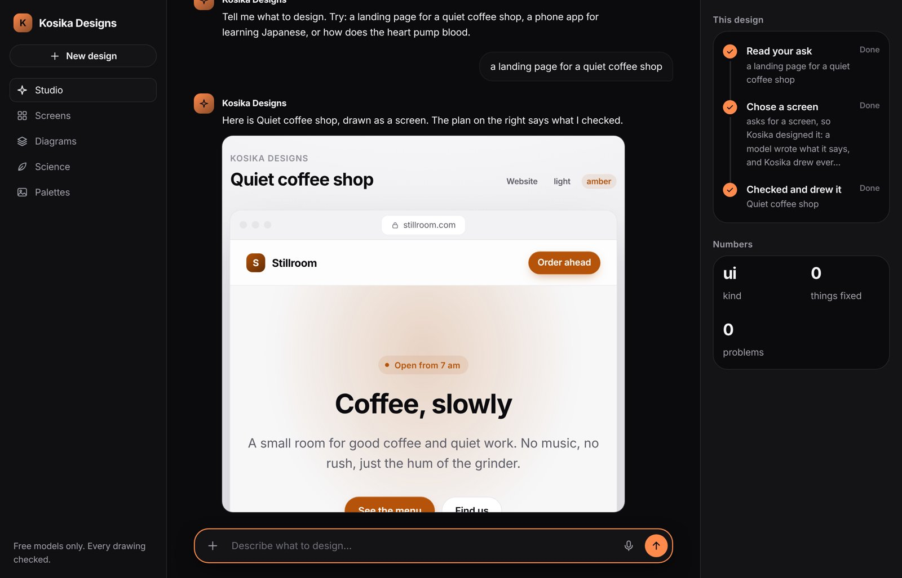

On a narrow screen the sidebar and panel fold away, so the same window
works on a phone.

### A flow, and when Kosika shows no photo

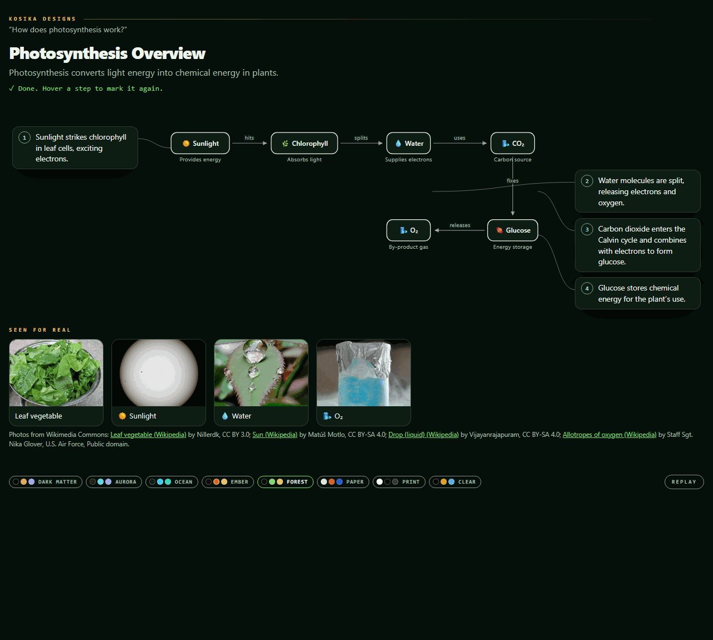

Kosika decides when a photo helps. It shows at most four. Some parts never
get a photo:

- graphs, comparisons, timelines and figures of mathematics
- chemicals, gases, energy and particles, which no camera can show
- any part where the matching Wikipedia article's own picture is a drawing
  or is missing

For example, oxygen and glucose get an icon here and no photo.

### A graph, with its mathematics worked and checked

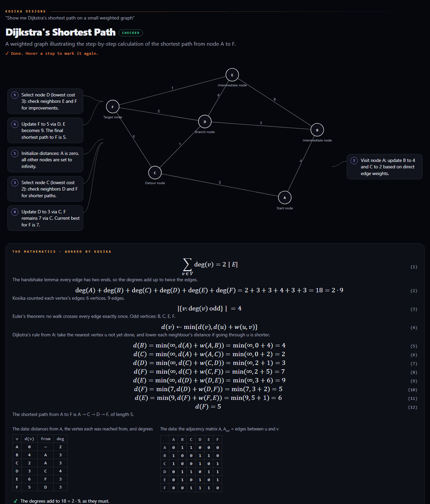

Kosika works the shortest path itself, one line at a time. It also checks
the handshake lemma and Euler's theorem, and shows the distance table and
the adjacency matrix. If the model's explanation gets a number wrong,
Kosika writes the correction next to it.

### Mathematics written as a paper

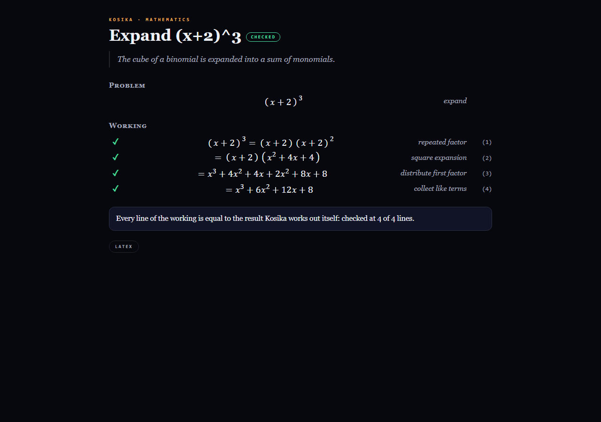

The model writes the working. Kosika checks every line against its own
result (`std/math.kos`) and corrects any line that is wrong. The page can
be exported as LaTeX.

### When the answer is words

Some questions are better answered in words than with a drawing. Kosika
answers these in words: something to write (a poem, an email), a greeting,
or a short fact such as the capital of a country.

### A real photo, measured


Kosika traces the sunflower's spirals on a real photo and counts them. A
count is called Fibonacci only when it is close to Fibonacci numbers.

### Palettes

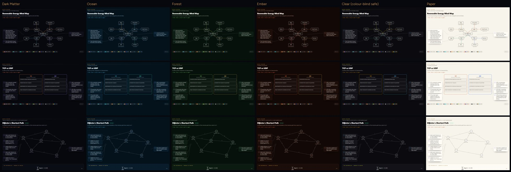

There are eight palettes. Dark Matter is the default, and Clear is safe for
colour-blind readers (Okabe–Ito). Kosika checks every palette's contrast
against WCAG before using it (`std/designs_palette.kos`).

## The files

Kosika Designs is part of Kosika's standard library, so any program can use
it: `import "std/designs.kos"` and call `design`. Kosika then draws a
diagram, an animated illustration, moving art, or one canvas of all three.

| File | What it does |
| --- | --- |
| `kosika/std/designs.kos` | The front door: chooses how to draw, and answers every place in one shape |
| `kosika/std/designs_main.kos` | Reads the question, plans the diagram and describes it |
| `kosika/std/designs_draw.kos` | Lays out and draws every kind of diagram, checks it, and writes the page |
| `kosika/std/designs_art.kos` | Animated illustrations, with their geometry and motion worked by Kosika |
| `kosika/std/designs_generative.kos` | Moving generative art |
| `kosika/std/designs_palette.kos` | Holds the palettes and checks their contrast |
| `kosika/std/designs_paper.kos` | Writes mathematics as a paper and checks each line |
| `kosika/std/designs_ui.kos` | Designs websites, phone screens, agent windows and artifacts in one design system |
| `explain.kos` (here) | An agent that answers in words and draws a canvas beside them |
| `sunflower.kos`, `studio.kos` (here) | Traces and measures a real sunflower photo |
| `ui.ps1`, `ui/` (here) | Designs a screen from one sentence; sample descriptions, their renderer, and Designs Studio (`ui/apps/`), a window that runs |
| `eyes.py` (here) | Finds freely licensed photos on Wikipedia and Wikimedia Commons |
| `art/` (here) | Hand-made illustrations and their README |

Kosika AI Chat (in the [kosika-app](https://github.com/blackhole8080-darkmatter/kosika-app) repo) shows these drawings as its answers.

Photos in the screenshots are from Wikimedia Commons, under the licences
credited on each page.
