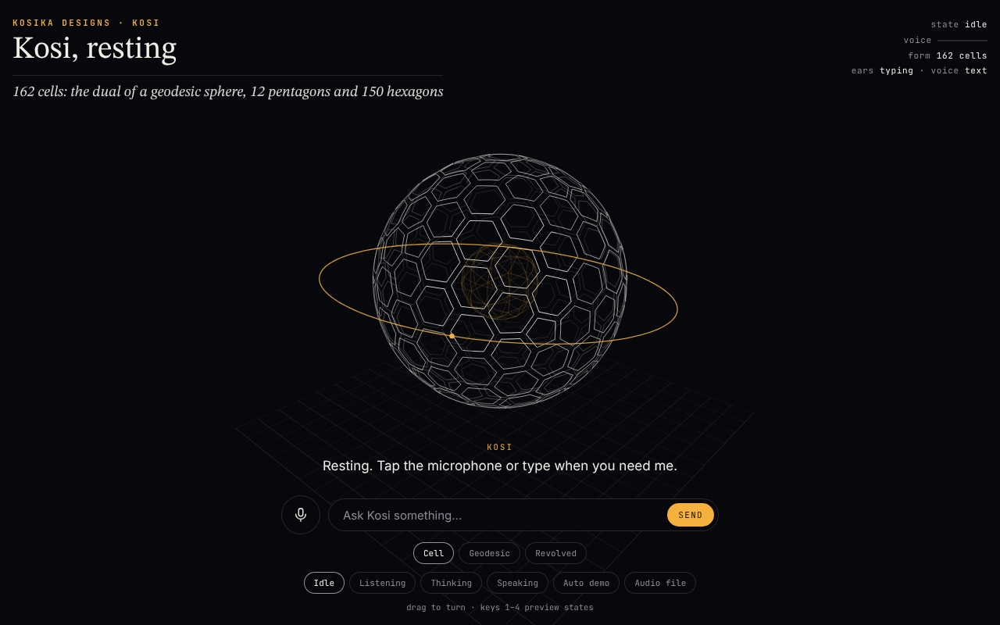
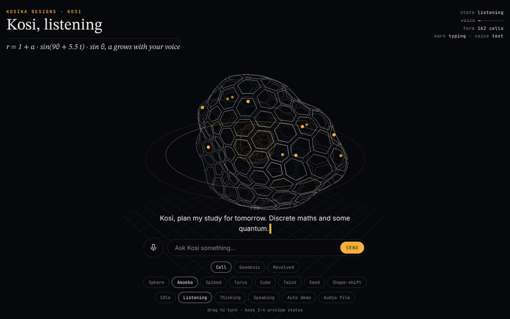
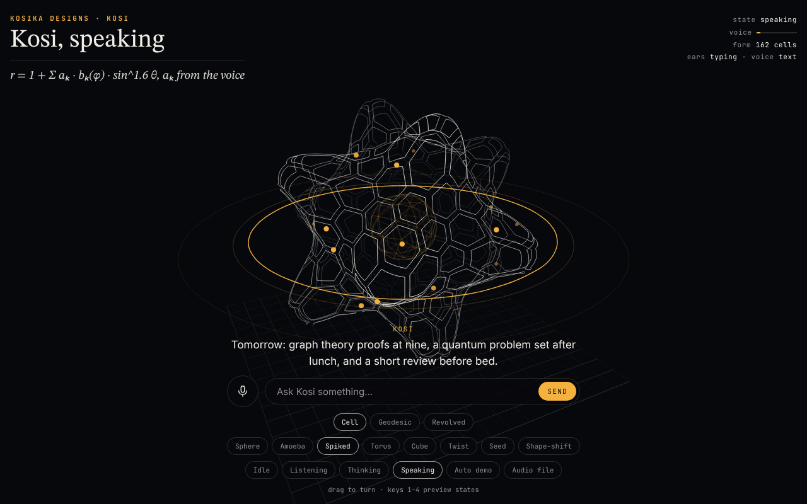
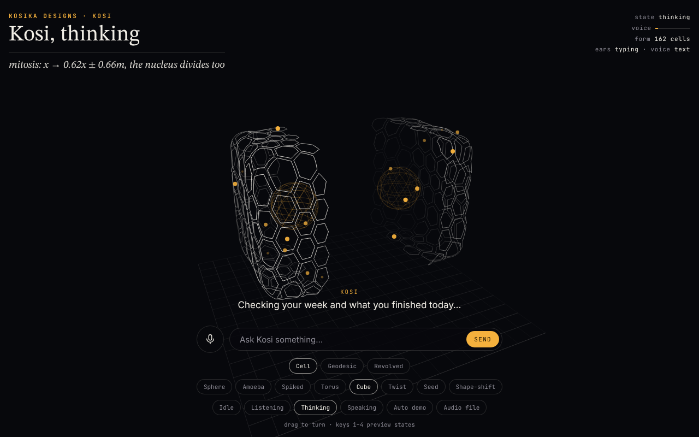

# Kosi, the living cell

Kosi is Kosika's assistant. Here it is drawn the way Kosika draws maths: white lines in 3D, faded by depth, on a floor grid, with amber for whatever moves. Kosika means *cell*, so Kosi is a cell.



Open `index.html` in a browser to see it live. Drag to turn it, use keys 1–4 to preview the states, and type to talk (the page answers with a short sample line when no model is connected).

## What it shows

| State | What happens |
|---|---|
| Resting | The cell breathes, an amber orbit circles it, and a geodesic nucleus turns inside. |
| Listening | Waves run over the membrane, `r = 1 + a·sin(9θ + 5.5t)·sin θ`, growing with the voice. Amber rings close in. |
| Thinking | The cell divides in two (mitosis), and the nucleus splits too. |
| Speaking | The voice pushes the shape outward, an amber ring traces the sound, and cells light up. |

**Forms**: *Cell* is a membrane of 162 cells, the dual of a geodesic sphere (a Goldberg polyhedron, 12 pentagons and 150 hexagons). *Geodesic* is an icosahedron with each face cut into 25 triangles. *Revolved* is a circle revolved into meridians and parallels, and it becomes a trefoil knot while thinking.

**Bodies**: sphere, amoeba, spiked, torus, cube, twist and seed. Every body maps a direction on the sphere to a point, so the same cells live on any body and flow between them. *Shape-shift* changes the body every few seconds, and `KosiCell.topicShape(text)` picks a body that suits what Kosi is saying (maths → torus, code → cube, life → amoeba).

| | | |
|---|---|---|
|  |  |  |

## Use it anywhere

`kosi-cell.js` has no dependencies (Canvas 2D). The phone app in kosika-site uses it for Kosi's talk screen.

```html
<canvas id="kosi" style="width:100%;height:100%"></canvas>
<script src="kosi-cell.js"></script>
<script>
  const kosi = KosiCell.create(document.getElementById("kosi"), { ground: null, floor: false });
  kosi.setState("listening");               // idle | listening | thinking | speaking
  kosi.setVoice(0.6, new Array(16).fill(0.5)); // level 0..1 and 16 bands
  kosi.setShape(KosiCell.topicShape("a proof in geometry") || "sphere");
  let last = performance.now();
  requestAnimationFrame(function frame(ms) { kosi.draw(ms / 1000, (ms - last) / 1000); last = ms; requestAnimationFrame(frame); });
</script>
```

Options: `ink` and `accent` (line colours), `ground` (background colour, or `null` for transparent), `floor` (the grid), `cy` (centre height, 0–1) and `size` (radius as a share of the short side).
